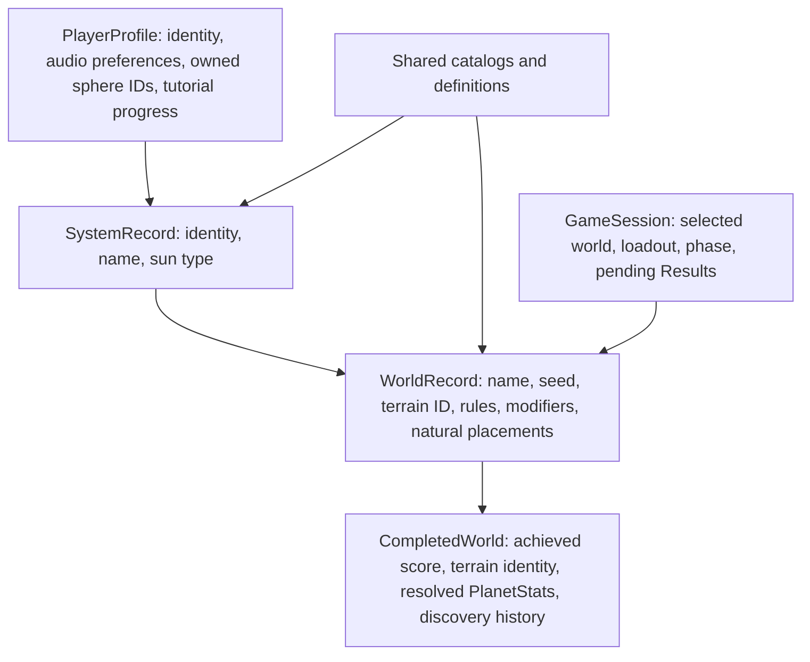

# Runtime architecture

EcoSphere separates shared content definitions, the active player profile, and scene-local gameplay state. `GameServices` is the composition root; the persistent `GameServicesHost` exposes the active phase/profile and resets services on exit. Services are ordinary C# objects rather than a hierarchy of interchangeable global MonoBehaviour managers.

## Ownership and queries

- `ProfileService` owns the active profile and indexes its systems. Its TryGetSystem/completion queries never generate or unlock systems. It explicitly generates systems, answers ownership queries, persists changes when enabled, and publishes `Changed`. The profile's systems are the currently unlocked/generated universe; this refactor retains existing navigation instead of introducing new unlock gates.
- `PlayerProfile` owns systems, unlocked sphere IDs, stable identity/display name, audio preferences, claimed predefined worlds and tutorial progress. No independent flat completed-world list exists in the live model.
- `SystemRecord` owns planets. Its name and sun ID are stored data. `IsComplete` derives from all its planets rather than another saved flag. New systems currently use the catalog's default Yellow Star. Other sun effects and unlock requirements require future content/design decisions.
- `WorldRecord` (the game's planet/level record) owns its rules and optional completion. Highest score is retained independently from the achieved score in its immutable-by-convention completion snapshot. `IsComplete` derives from the completion; stars derive from highest score and that planet's thresholds.
- `CompletedWorld` stores the resolved `PlanetStats`, sea level, rotation, terrain seed/style identity and discoveries. Legacy appearance accessors read the same stats; there are no duplicate saved cloud/water/heat fields. `PlanetVisualStyle` resolves terrain IDs for gameplay and completed previews.
- `PlanetProgressService` performs completion and discovery transactions. Both recipe and natural discoveries call the same grant operation and ownership check. Completion reads the planet's recipe minimum directly. Reopening Results reads historical discoveries without rewarding them again.
- `WorldLevels` is a convenience query into the active profile, not another data store. LevelPrep's older static context properties forward to GameSession for compatibility with existing editor checks; they store nothing.

## Definitions versus generated records

Sphere, recipe, modifier, predefined-world, terrain and sun definitions remain shared authoring content. World generation copies world rules, modifier IDs and natural placements into each planet once. It does not keep reevaluating generation templates when a saved planet is viewed.

Naturally occurring spheres are `NaturalSpherePlacement` records (sphere ID + board coordinate) in predefined-world data, copied into the generated planet. All layouts apply these placements before creating visuals. Releasing a sphere at a registered coordinate records its ID; successful completion can grant only those registered natural IDs. Beta still has an intentionally authored topology and guided ammo, but it has no dedicated Stone reward/unlock flag. DEV ownership suppresses both natural and recipe rediscovery consistently.

## Runtime services

- `GameSession` stores selected system/planet, defensive copies of pending and active loadouts, current phase, and pending Results. Retrying restores the selected loadout instead of silently replacing it with defaults.
- `SceneNavigation` (`GameServices.UI`) owns normal navigation to System, Setup, gameplay, retry and Results. Scene controllers retain their own layout, widgets and animations. Unique authored tutorial messages/topologies remain content.
- `PauseService` owns pause requests. Closing/destroying one modal releases only its request; another open modal keeps the game paused. Scene transitions explicitly clear old requests. It does not globally pause audio, allowing tutorial and discovery audio to finish.
- `AudioService` centralizes 2D source creation/configuration and profile master/music/effects/voice/UI gains. `LevelAudio` retains level-specific ducking and announcement sequencing; `MenuMusic` retains seamless menu-track lifetime; discovery controllers retain scheduled combination timing. Sources remain owned by the scene/effect that needs them, so cleanup does not leak sounds.
- `UIInput` ensures input exists independently of tutorials. UI event handling remains in the views.

Active board cells, shot physics, temporary elemental totals, and effect animations belong to the running level controller. They are not saved as permanent planet properties. Winning creates the completed planet snapshot, shows stars, and then opens Results through the shared navigation service.

## Persistence

`WorldSaveStore` writes schema version 2 atomically. It reads the existing `worlds-v1.json` location so enabling persistence finds older files. Version-1 migration moves flat completions into their systems' planets and converts the old Stone flag into an ordinary unlocked sphere ID. Old appearance fields are read only by the migration DTO. Unsupported/malformed profiles fail instead of silently discarding data.

Persistence remains off during development. Exiting/restarting Play resets the in-memory profile, session and service state. This change does not add a profile-selection UI, cloud saves, new progression gates, or randomized sun types.

## Verification

`ArchitectureTools.Configure` registers the existing Yellow Star and barren terrain in shared catalogs. Its checks cover nested completion, derived system completion, generic non-Stone natural discoveries, recipe discoveries, DEV suppression, v1 migration, profile round trips, overlapping pause requests and audio preference gain.

Runtime regressions exercise System/Setup/gameplay navigation, normal Stone discovery and historical Results, recipes and combination audio timing, tutorial pause/input guards, procedural selected loadouts, and actual pointer input on the star-screen Continue button. Planet-stat, world-generation, board and scoring checks remain applicable to the shared definitions.
